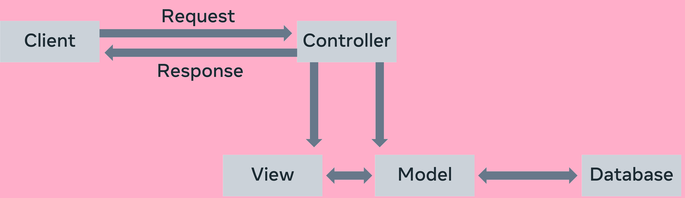
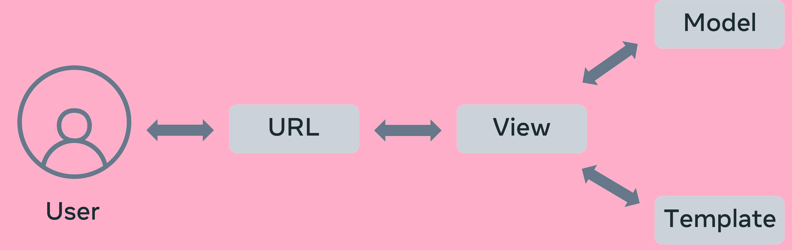

# Arquitectura MVC
La mayoría de los marcos web implementan la arquitectura MVC (Modelo-Vista-Controlador). 

El patrón de diseño MVC separa todo el proceso de desarrollo de aplicaciones web en tres capas, Modelo, Vista y Controlador. 

El siguiente diagrama explica la interacción de estas tres capas.



En el enfoque MVC, el controlador intercepta las peticiones del usuario. 

Se coordina con las capas de vista y modelo para enviar la respuesta adecuada al cliente.

El modelo es responsable de las definiciones de datos, la lógica de procesamiento y la interacción con la base de datos backend.

La vista es la capa de presentación de la aplicación.

Se encarga de la colocación y el formato del resultado y lo envía al controlador, que a su vez, lo redirige al cliente como respuesta de la aplicación.

# Arquitectura MVT
El marco Django adapta un enfoque de Modelo, Vista y Plantilla (MVT), una ligera variación del enfoque MVC.

Aquí también, el modelo es la capa de datos de la aplicación. La vista es, de hecho, la capa que se encarga de la lógica de procesamiento.

La plantilla es la capa de presentación.



Una aplicación Django consta de los siguientes componentes:

* Despachador de URL

* Vista

* Modelo

* Plantilla

## Despachador de URL
El mecanismo despachador de URL de Django es equivalente al controlador en la arquitectura MVC.

El módulo urls.py en la carpeta de paquetes del proyecto Django actúa como despachador.

Define los patrones de URL. Cada patrón de URL se mapea con una función de vista que se invocará cuando se encuentre que la URL de solicitud del cliente coincide con él.

También se incluyen los patrones de URL definidos en cada aplicación del proyecto. Este es el archivo urls.py en la carpeta app.
```python
from django.urls import path 
from . import views 

urlpatterns = [ 
    path('', views.index, name='index'), 
] 
```
Cuando el servidor recibe una solicitud en la URL del cliente, el despachador coteja su patrón con los patrones disponibles en urls.py.

A continuación, dirige el flujo de la solicitud hacia su vista asociada.

## Vista
La función de vista lee los parámetros de ruta, consulta y cuerpo incluidos en la solicitud del cliente Si es necesario, utiliza estos datos para interactuar con los modelos y realizar operaciones CRUD.

Una vista puede ser una función definida por el usuario o una clase.

Las definiciones de las vistas se crean en el archivoviews.pyde la carpeta del paquete de la aplicación correspondiente.

El siguiente código del archivo view.py define la función de vista index().

```python
from django.shortcuts import render 
# Create your views here. 
from django.http import HttpResponse 

def index(request): 
    return HttpResponse("Hello, world.") 
```

## Modelo
Un modelo es una clase de Python.

Una app puede tener una o más clases modelo, convencionalmente colocadas en el archivo models.py.

Django migra los atributos de la clase modelo para construir una tabla de base de datos de estructura coincidente.

El mapeador objeto-relacional de Django ayuda a realizar operaciones CRUD de forma orientada a objetos en lugar de invocar consultas SQL.

La vista utiliza los datos del cliente y del modelo y renderiza su respuesta utilizando una plantilla.

## Plantilla
Una plantilla es una página web que contiene una mezcla de HTML estático y bloques de código del Lenguaje de Plantillas Django.

Las páginas web de plantillas se colocan en la carpeta de *template* con la extensión ```.html```.

El procesador de plantillas de Django utiliza cualquier dato de contexto de la vista insertado en estos bloques para formular una respuesta dinámica.

La vista, a su vez, devuelve la respuesta al usuario.

Esto explica cómo la arquitectura MVT de Django maneja el ciclo petición-respuesta en una aplicación web.