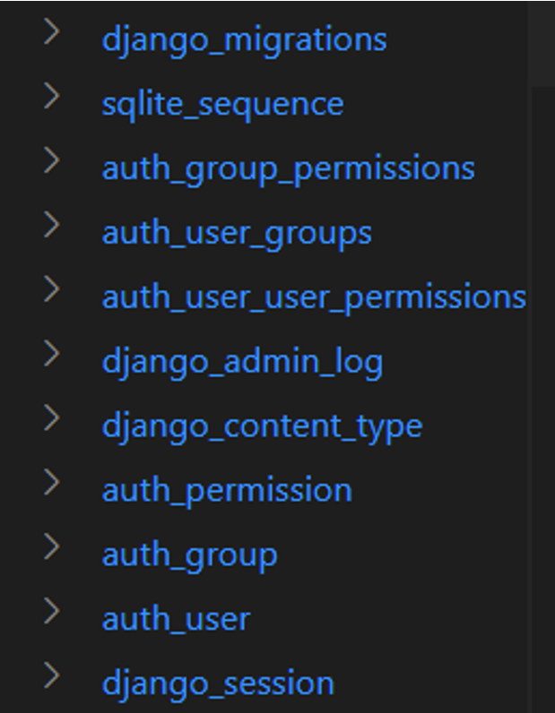

# Cómo utilizar las migraciones

Django traduce los modelos a las respectivas tablas de la base de datos backend con un mecanismo conocido como migración. También propaga cualquier cambio en la estructura del modelo como añadir, modificar o eliminar un atributo de campo de una clase del modelo a la tabla mapeada.

El sistema de migración de Django tiene los siguientes comandos:

* makemigrations

* migrate

* sqlmigrate

* showmigrations

La migración de Django es un sistema de control de versiones. Siempre que añada un nuevo modelo o realice cambios en un modelo existente, deberá ejecutar el comando makemigrations . Éste crea un script para realizar cambios en la tabla mapeada. Cada vez que ejecute el comando makemigrations y Django detecte los cambios, se creará un script con su nombre y número de versión. Para implementar los cambios según el script de migración, necesita ejecutar el comando migrate.

## Migración de modelos de APPS INSTALADAS

Cuando crea un proyecto Django con el comando startproject, ciertas apps se instalan por defecto. Estas apps aparecen en la sección INSTALLED_APPS del archivo settings.py del proyecto.
```python
INSTALLED_APPS = [ 
    'django.contrib.admin', 
    'django.contrib.auth', 
    'django.contrib.contenttypes', 
    'django.contrib.sessions', 
    'django.contrib.messages', 
    'django.contrib.staticfiles', 
]
```
Es necesario almacenar datos a través de estas apps para que su funcionalidad funcione. Por ejemplo, el paquete `auth` controla los usuarios, grupos y permisos, por lo que deben crearse las tablas correspondientes en la base de datos. Django utiliza por defecto la base de datos SQLite. Para ello, ejecute el comando migrate. 
``` bash
python manage.py migrate 
```
A continuación, se crean las tablas requeridas por el INSTALLED_APPS .



Vamos a crear una aplicación dentro de nuestro proyecto Django.
```bash
(django) C:\django\myproject> python manage.py startapp myapp 
```
Esto crea una carpeta de paquetes myapp dentro de la carpeta exterior myproject. Dentro de myapp, también se crea un paquete migrations, que está vacío para empezar.

# Utilizando el comando makemigrations 

Abra el archivo `models.py` y añádale un modelo de Person.
```python
from django.db import models 
class Person(models.Model): 
    name = models.CharField(max_length=20) 
    email = models.EmailField() 
    phone = models.CharField(max_length=20) 
```
El primer paso para crear la tabla Persona en la base de datos es ejecutar el comando `makemigrations`.
```bash
(django) C:\django\myproject>python manage.py makemigrations 
Migrations for 'myapp': 
  myapp\migrations\0001_initial.py 
    - Create model Person 
```

Observe que en el paquete migrations se crea un script de migración `0001_initial.py`. Indica lo que el script pretende hacer, que es: Create model Person.

Si abre el archivo migration, encontrará en él una clase de migración.
```python
from django.db import migrations, models  

class Migration(migrations.Migration): 

    initial = True 

    dependencies = [ 
    ] 

    operations = [ 
        migrations.CreateModel( 
            name='Person', 
            fields=[ 
                ('id', models.BigAutoField(auto_created=True, primary_key=True, serialize=False, verbose_name='ID')), 
                ('name', models.CharField(max_length=20)), 
                ('email', models.EmailField(max_length=254)), 
                ('phone', models.CharField(max_length=20)), 
            ], 
        ), 
    ] 
```

Como se ha mencionado anteriormente, necesita ejecutar el comando `migrate` para aplicar las tareas del archivo migrations que se van a realizar.
```bash
(django) C:\django\myproject>python manage.py migrate        
Operations to perform: 
  Apply all migrations: admin, auth, contenttypes, myapp, sessions 
Running migrations: 
  Applying myapp.0001_initial... OK 
```

Revise en db.sqlite3 la tabla creada con sus campos.

# Control de versiones
Ahora, vamos a modificar la clase modelo persona cambiando el campo `name` por `person_name` y ejecutando de nuevo `makemigrations`.
```bash
(django) C:\django\myproject>python manage.py makemigrations 
Was person.name renamed to person.person_name (a CharField)? [y/N] y 
Migrations for 'myapp': 
  myapp\migrations\0002_rename_name_person_person_name.py 
    - Rename field name on person to person_name 
```

Se crea un segundo script de migración en la carpeta migrations. Antes de finalizar el cambio, añada un nuevo campo `edad` en el modelo de persona y ejecute de nuevo makemigrations.
```bash
(django) C:\django\myproject>python manage.py makemigrations 
Migrations for 'myapp': 
  myapp\migrations\0003_person_age.py 
    - Add field age to person 
```

## Comando showmigrations

Ahora hay dos cambios sin migrar en el modelo. Ejecute el comando showmigrations:
```bash
(django) C:\django\myproject>python manage.py showmigrations 
. . . 
. . . 
myapp 
[X] 0001_initial 
[ ] 0002_rename_name_person_person_name 
[ ] 0003_person_age 
. . . 
```

La migración inicial (fichero numerado 0001) ya ha migrado. La marca X es indicativa de ello. Sin embargo, las dos migraciones siguientes no muestran la marca X, lo que significa que están pendientes. Si ejecutamos el comando migrate, ambas modificaciones se reflejarán en la estructura de la tabla.
```bash
(django) C:\django\myproject>python manage.py migrate        
Operations to perform: 
  Apply all migrations: admin, auth, contenttypes, myapp, sessions 
Running migrations: 
  Applying myapp.0002_rename_name_person_person_name... OK 
  Applying myapp.0003_person_age... OK 
```

Como se mencionó anteriormente, el mecanismo de migración de Django proporciona un eficiente control de versiones. Es posible que desee recurrir a la estructura de la tabla antes de añadir el campo age. Ejecute el comando migrate y especifique qué archivo de migración se utilizará para que las migraciones posteriores se deshagan o no se apliquen.
```bash
(django) C:\django\myproject>python manage.py migrate myapp 0002_rename_name_person_person_name   
Operations to perform: 
  Target specific migration: 0002_rename_name_person_person_name, from myapp 
Running migrations: 
  Rendering model states... DONE 
  Unapplying myapp.0003_person_age... OK 
```

# Comando sqlmigrate
Por último, el comando `sqlmigrate` muestra la consulta o consultas SQL ejecutadas cuando se ejecuta un determinado script de migración. Por ejemplo, la primera migración sobre el modelo de personas de myapps tiene por objeto crear la tabla de personas. El comando `sqlmigrate` para este script muestra la sentencia CREATE TABLE para este fin.
```bash
(django) C:\django\myproject>python manage.py sqlmigrate myapp 0001_initial  
BEGIN; 
-- 
-- Create model Person 
-- 
CREATE TABLE "myapp_person" ("id" integer NOT NULL PRIMARY KEY AUTOINCREMENT, "name" varchar(20) NOT NULL, "email" varchar(254) NOT NULL, "phone" varchar(20) NOT NULL); 
COMMIT; 
```
---
# __str__()
Model.__str__()
El método se llama cada vez que llamas a un objeto. Django se utiliza en varios lugares. Lo más notable es mostrar un objeto en el sitio de administración de Django y como valor insertado en una plantilla cuando Muestra un objeto. Por tanto, siempre deberías devolver un libro agradable y legible para humanos representación del modelo del método.
```python
from django.db import models


class Person(models.Model):
    first_name = models.CharField(max_length=50)
    last_name = models.CharField(max_length=50)

    def __str__(self):
        return f"{self.first_name} {self.last_name}"
```
---

En esta lectura, ha aprendido acerca de cuándo utilizar las migraciones, las mejores prácticas y que el sistema de migración en Django gestiona la creación y modificación de datos de manera muy eficaz y eficiente.